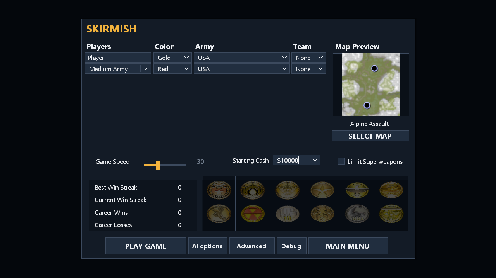
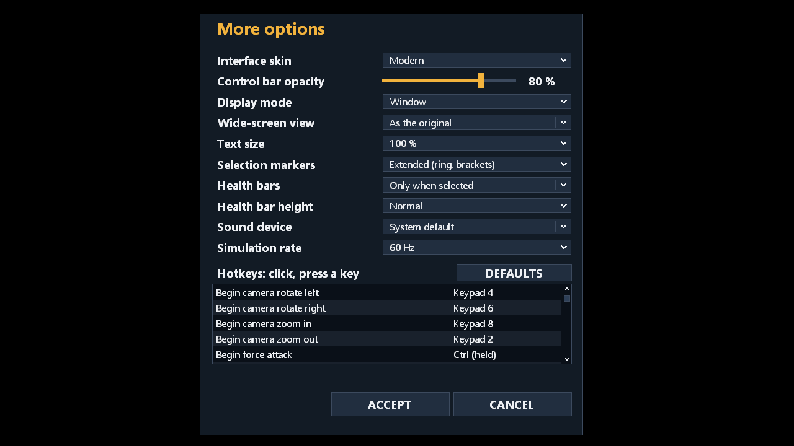

# CnCNew

**A new engine for *Command & Conquer™ Generals – Zero Hour*.** CnCNew is a clean, from-scratch reimplementation of the game's runtime in C#/.NET 10 with a
Direct3D 11 client (Stride). It plays the game you already own – with a modern user interface, a replay browser, an observer mode, a match analysis, stronger and
selectable computer opponents, and multiplayer skirmishes through dedicated servers. The community patch *GeneralsGamePatch* is part of the game it runs.

> **You need your own copy of the game.** CnCNew contains **no game data** – no models, textures, sounds, maps, movies or text of the original. It builds a new,
> local game folder from *your* copy of the English Steam version of *Command & Conquer Generals – Zero Hour*; your Steam installation is only read, never changed.
> Without that copy there is nothing to play. See [Legal matters](#legal-matters).

<!--
SCREENSHOTS (not enabled: the pictures show the original game's art and so must not be committed - the owner decides whether and where they are published).
To enable them: make the pictures with `pwsh scripts/capture-readme-screenshots.ps1` (it writes outside the repository), copy them to docs/screenshots/ (git-ignored),
check them, publish them on a host of your choice, and replace the comment markers around the block below with real image links.

## Screenshots

| | |
|---|---|
|  |  |
|  |  |
|  |  |
|  | |
-->

## Contents

- [Status – read this first](#status--read-this-first)
- [What you get](#what-you-get)
- [Requirements](#requirements)
- [Install in three clicks](#install-in-three-clicks)
- [First start](#first-start)
- [Features](#features)
- [Controls](#controls)
- [Settings and where things are kept](#settings-and-where-things-are-kept)
- [Hosting a server](#hosting-a-server)
- [Limits](#limits)
- [Legal matters](#legal-matters)
- [For developers](#for-developers)
- [Contributing, licence, credits](#contributing-licence-credits)

## Status – read this first

CnCNew is **young software in test, not a finished product.** Single player (skirmish and the campaign missions) and multiplayer skirmishes run and have been
checked extensively by programs – a deterministic reference suite, thousands of automated tests, scripted clicks through the real client, and long runs of dedicated
servers. They have been played and judged by the project owner in several rounds of playtests, and every finding of those rounds was fixed or written down. They have **not**
been played by a wider public, **not** on a second physical machine over a real network, and **not** by anyone for hundreds of hours. Expect bugs, rough edges and
behaviour that differs from the original in places; the known differences are written down in the repository (see [Limits](#limits)).

What this is **not**: not a mod of the original program, not a download of the game, not a substitute for buying it, and not affiliated with or endorsed by
Electronic Arts.

## What you get

- the game's **skirmish** mode against computer opponents and the **campaign** missions (including the Generals' Challenge), running on the original's own data and
  map scripts;
- a **modern user interface** (default) drawn from the original's layouts, with the original skin one setting away;
- a **60 Hz deterministic simulation** (30 and 120 Hz also supported) that lets replays, saved games and multiplayer agree to the last bit;
- **multiplayer skirmishes** for up to eight players with computer slots, through dedicated servers (lockstep, encrypted connections), with watchers and rejoin;
- a **replay browser**, an **observer** with an event ticker, and a **match analysis** with charts and an HTML report;
- **tactics profiles and strengths** for the built-in computer players, and the original skirmish AI as an alternative;
- the community patch **GeneralsGamePatch** and a set of reviewed fixes applied, so the game plays as the patched game does.

## Requirements

- **Windows 10 or 11, 64-bit.** Windows is the only supported platform for the game. (The dedicated server also runs on Linux.)
- A graphics card and driver with **Direct3D 11**.
- **Your own copy of *Command & Conquer Generals – Zero Hour*, the English Steam version** (Steam app 2732960), installed. Other versions, languages and editions
  (disc, Origin/EA app, other Steam languages, modified installations) are refused with a plain message: the installation is checked file by file against the one
  version this project knows.
- About 3 GB of free disk space for the game folder, and an internet connection once, to fetch the community patch (roughly 100 MB, every file checked
  against a recorded hash).
- You do **not** need to install .NET: the release client is self-contained.

## Install in three clicks

1. **Download** `CnCNew-Launcher-<version>.exe` from the [Releases page](https://github.com/cpfaffinger/CnCNew/releases) (each release lists a `.sha256` file beside every
   download).
2. **Run** it. It finds your Steam installation, checks it, and offers to install CnCNew into a folder you choose (the default is `CnCNew` in your user folder). It
   downloads the client, fetches the community patch and makes the game folder from your copy of the game.
3. **Play.** The launcher starts the game, and starts it again next time; when a new release exists it offers to update.

The launcher never writes into your Steam folder and never sends anything anywhere. If it stops, the window says why in plain words; see
[docs/TROUBLESHOOTING.md](docs/TROUBLESHOOTING.md).

*Until the first release is published*, or if you prefer to see what is installed, clone this repository and run `CnCNew-Launcher.cmd` in it: that launcher checks
the machine, installs what is missing (with your click), builds the client from source and makes the game folder. You can also work by hand:
[docs/INSTALLATION.md](docs/INSTALLATION.md) describes every step, the patcher, and what it checks.

## First start

The first start takes a little longer than later ones: the client prepares its shaders and reads the game's data. The intro movies play (they can be skipped, or turned
off with `--no-intro`), and the main menu opens in the modern skin. From there:

- **Solo Play** for the campaign and the **Skirmish** setup (map, factions, colours, teams, starting cash, the computer opponents' engine, tactics and strength);
- **Multiplayer > Network** to join, host or watch a game on a server;
- **Load** for saved games and the replay browser (replays);
- **Options** for graphics and sound, and **More options** for the skin, display mode (windowed, borderless or full screen), wide-screen view, text size, sound
  device and hotkeys.

Maps you made or downloaded in your own Zero Hour maps folder (`Documents\Command and Conquer Generals Zero Hour Data\Maps`) are found and played as well.

## Features

**Modern interface.** Menus, the in-game bar, the lobby, the replay list and the analysis are drawn in a clean, flat style with readable text at any resolution,
from the layouts the original game ships (the original's art – cameos, portraits, map previews – stays). The original skin is selectable in *More options* (or
`--skin original`). Details: [docs/UI-MODERN.md](docs/UI-MODERN.md).

**Replay browser.** Every skirmish you play – locally or on a server – is recorded when it ends. *Load > Replay* lists the files with their state against your
build (and says why one does not play), and plays one back with pause, speed control, seeking and the view of one player or everything. Replays are exact: the match
is simulated again and checked against recorded hashes. Replays play only in the build that made them.
[docs/REPLAY-BROWSER.md](docs/REPLAY-BROWSER.md).

**Observer.** Watch computer players (or any replay) with an event ticker – first blood, buildings lost, superweapons, captures, defeats – a click on a line takes
the camera there; switch between the view of every player or of everything; a research tab shows what each player has bought.
[docs/SPECTATOR-MODE.md](docs/SPECTATOR-MODE.md).

**Match analysis.** After a match (from the score screen's *Analysis* button) or for any replay: money, income, spending, army value and composition, units and buildings
built and lost, kills, upgrades and sciences, superweapons, orders per minute, the regions each player held, and heat maps of movement and fights. It can also be
exported as JSON, TSV and a self-contained HTML report. [docs/MATCH-ANALYSIS.md](docs/MATCH-ANALYSIS.md).

**Computer opponents.** Each computer slot has a *tactics profile* (balanced, rush, turtle, economy) and a *strength* (easy, medium, hard – how well the AI sees and how
fast it decides; never a cheat on resources). The original skirmish AI is available too, with the original's three difficulty levels. Computer opponents do not get a
rule advantage; balance has been measured but not judged by many players. [docs/SKIRMISH-AI.md](docs/SKIRMISH-AI.md).

**Multiplayer.** Up to eight players and computer slots in one skirmish, lockstep over UDP through a dedicated server (or "Host" from the game's menu), authenticated and
encrypted, with a lobby, chat, team chat, pause, votes, a player who loses the connection keeping the seat and coming back, and watchers on a delay. The same match is simulated on every
machine and every tick is checked by hash; a mismatch is named down to the object and field. No matchmaking or ladder: you name the server and the room.
[docs/NETWORK-PROTOCOL.md](docs/NETWORK-PROTOCOL.md), [docs/MULTIPLAYER-FINDINGS.md](docs/MULTIPLAYER-FINDINGS.md).

**Saved games.** A running skirmish can be saved and continued, including the computer players' state.

**Fidelity and fixes.** The simulation follows the original's behaviour, read from the original's source and checked against it case by case; a long list of such
cases was ported (docs/SIMULATION-CORE.md, docs/plan/STAGE-1-PORT.md). On top of that sit the community patch and a reviewed set of fixes
([docs/PATCH-LAYER.md](docs/PATCH-LAYER.md), [docs/GGC-FIXES.md](docs/GGC-FIXES.md)). The original, unpatched rules remain selectable (`--rules original`) for comparison.

## Controls

The game keeps the original's controls; the hotkeys are the original's (`CommandMap.ini`) and **can be rebound** in *Options > More options*.

| | |
|---|---|
| Select | left click; drag a box; double click selects all of the kind in view; **Ctrl+number** makes a control group, the number recalls it |
| Order | right click to move, attack, capture, enter or garrison, depending on what is under the pointer; **Ctrl+click** on the ground attacks the place |
| Camera | arrow keys or the screen edge scroll; hold the right mouse button and move to scroll; hold the middle button to rotate; click the middle button to reset the view; wheel zooms |
| Jump | **Space** to the place of the last event (radar notice); the idle-worker button on the bar |
| Mixed selection | **Tab** walks through the kinds in the selection, and the command bar follows |
| Build / train | click the cameo, or press its underlined key |
| Multiplayer | **Enter** chats to everyone, **Backspace** to your allies; `/kick`, `/end`, `/speed`, `/yes`, `/no` for votes |
| Replay / observer | Home, PageUp, PageDown on the replay line; **F4** shows everything, **F5–F12** the view of players 1–8; **T** ticker, **G** go to the event, **R** research tab |

The exact bindings of your build are listed (and changeable) in *More options*; the source of the behaviour is [docs/PRESENTATION-INPUT.md](docs/PRESENTATION-INPUT.md).

## Settings and where things are kept

| What | Where |
|---|---|
| The game folder (content, client) | the folder you chose in the launcher (default `%USERPROFILE%\CnCNew`) |
| Settings and saved games, replays | `%APPDATA%\CnCNew` |
| Logs, crash reports, keys | `%LOCALAPPDATA%\CnCNew` |

Nothing is sent anywhere. When something goes wrong, the client can write a *support bundle* (logs and crash reports, never a key or a saved game) that you attach to
a bug report: `CnCNew.Client.Stride.exe --support-bundle bundle.zip`. See [docs/TROUBLESHOOTING.md](docs/TROUBLESHOOTING.md). Useful start options: `--skin
original|modern`, `--rules original`, `--no-intro`, `--no-shell-map`, `--user-maps DIR`, `--tick-rate 30|60|120`.

## Hosting a server

*Host game* in the multiplayer menu runs a server inside your game. For a machine that stays up, the **dedicated server** is a separate self-contained package (Windows
and Linux) in each release: `CnCNew-Server-<version>-win-x64.zip` or `-linux-x64.zip`. Unpack it (the Linux package needs OpenSSL), copy `server.sample.json` to `server.json`, and start it; it listens on
one UDP port (27960 by default), makes its own key on the first start (players check its fingerprint the first time they connect) and can protect rooms with a password,
require player keys and keep a ban list. Configuration, limits, logging and the threat model: [docs/DEDICATED-SERVER.md](docs/DEDICATED-SERVER.md) and the `START.md`
in the package. Everyone in a match must run the **same build** – the client and the server refuse each other otherwise.

## Limits

Honestly stated:

- **Windows only** for the game; **English Steam installation only** (no other language, no disc or EA-app copy). The interface texts are English.
- **Single player and skirmish**, plus **dedicated-server multiplayer skirmishes**. Not built and not planned: networked campaign, matchmaking and ladders, NAT traversal,
  GameSpy, anti-cheat, compatibility with old mods and old saved games or replays (every build plays only its own replays).
- **Little real-world testing.** Multiplayer has been exercised on one machine – many processes, loopback and simulated bad lines, a Linux server in WSL – but not yet over the
  internet between several PCs.
- **It is not the original, bit for bit.** The simulation was ported case by case from the original's source and the patched game's data, and the differences found so far are fixed
  or listed (`docs/plan/STAGE-1-PORT.md`, "fidelity register"). Computer opponents differ from the original's; balance is measured but not judged.
- Performance is fine on current hardware for what was measured (an eight-player match uses a small part of one core for the simulation), but an occasional long frame
  on very large battles is a known item (`docs/PERFORMANCE.md`).
- Shadows, effects and many details are reconstructed from the original's mechanisms; some will look different from what you remember. Tell us.

If you find a difference or a bug, an issue with the support bundle and the steps is the most useful thing you can send.

## Legal matters

- **Your own copy is required.** The repository and the releases contain no game data and nothing exported from it – only code, and checksums, sizes, names and counts for
  checking (`baselines/`). The rights to the game data lie with Electronic Arts Inc.; the release packages are checked by a script (`scripts/check-separation.ps1`) to hold no game file.
- **Licence:** `GPL-3.0-or-later` ([LICENSE.md](LICENSE.md)). The code was written with reference to the source code Electronic Arts published under GPL v3 (with additional
  terms) and to community projects; it is a newly written implementation, marked as such, not the original program. Details, the additional terms and the licences
  of third-party components are in [NOTICE.md](NOTICE.md) and [docs/THIRD-PARTY.md](docs/THIRD-PARTY.md).
- **Trademarks:** "Command & Conquer", "Generals" and "Zero Hour" are trademarks of Electronic Arts Inc. This project is not affiliated with Electronic Arts and is neither
  supported nor endorsed by Electronic Arts.
- The community patch *GeneralsGamePatch* is fetched from its own repository at a recorded commit (every file checked by hash) and is the work of its authors.

## For developers

Restoring the whole developer state on another machine takes a clone and one script. It checks the prerequisites, clones the reference sources into `references/` at the
recorded commits, exports `game/content` from your Steam installation, builds and checks against the baselines (each step can be skipped; running it again repairs):

```powershell
git clone https://github.com/cpfaffinger/CnCNew.git
pwsh CnCNew/scripts/setup-dev.ps1        # options: -ShallowReferences -GameDir <path> -SkipReferences -SkipContent -SkipBuild -SkipCheck
```

The single steps:

```powershell
pwsh scripts/get-references.ps1          # the upstream repositories to <repo>\references (git-ignored); -Shallow, -Only <name>
pwsh scripts/dev-content.ps1             # developer installation to <repo>\game (git-ignored): game\content
dotnet build CnCNew.slnx                 # clean build: 0 warnings (TreatWarningsAsErrors)
dotnet run --project tests/CnCNew.Simulation.Tests
dotnet run --project tests/CnCNew.Simulation.Tests -- --content-dir game/content
dotnet run --project tools/CnCNew.IniTool -- compat-check game/content baselines/compatibility.json
```

Full requirements (Git, .NET SDK per `global.json`, PowerShell 7, Python 3) and the pitfalls of a fresh machine are in [BUILDING.md](BUILDING.md). Which checks a change needs
is fixed in [docs/TESTING.md](docs/TESTING.md): `pwsh scripts/test.ps1` before a commit, `-Tier gate` before a push of code, `-Tier full` at the triggers named there. Tests are
standalone console programs (no xUnit/NUnit); the complete list of programs, audits and tools is in [CLAUDE.md](CLAUDE.md), section "Build, tests, audits".

How it is built: layers import → runtime content → data models → simulation → presentation, with hard dependency rules ([docs/ARCHITECTURE.md](docs/ARCHITECTURE.md)). The
simulation is deterministic (fixed point, no wall clock, no ambient randomness) and measured against a reference manifest (`baselines/reference-manifest.json`,
[docs/DETERMINISM.md](docs/DETERMINISM.md)). Releases are made by tag, see [docs/RELEASING.md](docs/RELEASING.md).

| Directory | Content |
|---|---|
| `src/` | the libraries and the client: `CnCNew.Archives`, `.IO`, `.Import` (import side), `.Content` (runtime file system), `.Formats`, `.Images`, `.W3D`, `.Audio`, `.Video` (formats), `.Data` (typed definitions), `.Simulation` (deterministic core), `.Net`, `.Server` (multiplayer), `.Presentation`, `.Ui`, `.Game` (game layer, shell, HUD), `.Client.Stride` (Windows client) |
| `tools/` | console tools: `AssetTool` (import, installation), `IniTool`, `MapTool`, `ImageTool`, `W3dTool`, `SimTool` (reference runs, manifests, performance), `CampaignTool`, `PresentationTool`, `NetTool`, `DedicatedServer`, `UiRenderTool` |
| `tests/` | one test program per project, synthetic fixtures |
| `scripts/` | PowerShell scripts: installation, developer content, demos, captures, audits, packages, release |
| `baselines/` | checked-in yardsticks: compatibility baseline, input and reference manifests, descriptions of the supported game and patch versions (only paths, sizes, checksums) |
| `docs/` | documentation; entry point is [docs/README.md](docs/README.md) |

Not in the repository and ignored by Git: `game/` (developer installation), `.local/` (local working data), `references/` (foreign source code for reading), `docs/screenshots/`,
`bin/`, `obj/`. The plan and the history of the work: [docs/plan/PROGRAMME.md](docs/plan/PROGRAMME.md) (four stages: port, engine, changes, multiplayer). The code is written
predominantly by coding agents under the direction of the project owner; [CLAUDE.md](CLAUDE.md) (with the pointer [AGENTS.md](AGENTS.md)) is their binding working instruction and
the most precise record of the measured state.

## Contributing, licence, credits

- **Contributing:** [CONTRIBUTING.md](CONTRIBUTING.md). Bug reports with the support bundle are welcome. Game data or anything exported from it is never committed.
- **Licence:** GPL-3.0-or-later, [LICENSE.md](LICENSE.md); [NOTICE.md](NOTICE.md) explains the additional terms and what this project is and is not.
- **Credits:** Electronic Arts / Westwood Studios, for the game and for the source code released under GPL v3; the authors of *GeneralsGameCode*, *GeneralsGamePatch*
  and *Zero Hour Reforged* (read as references, never copied); the [Stride](https://www.stride3d.net/) engine; and the .NET team. Third-party packages and their licences:
  [docs/THIRD-PARTY.md](docs/THIRD-PARTY.md).
